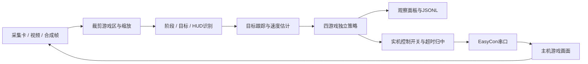

# Splatoon Raiders Minigame Helper

通过采集卡获取画面，通过旧项目的 EasyCon 控制器向主机发送按键。现已加入 HOPPING、JUGGLING、LANDING 的参考视频识别、轨迹分析与操作建议；**尚未完成实机自动通关或刷分验证**。

## 启动

优先使用当前 conda base 环境。在项目目录运行：

```powershell
python run.py gui
```

也可以双击 `start.cmd`。选择小游戏、保留“合成演示”，点击“启动观察”，可查看检测框、运动跟踪、策略建议与日志。合成演示使用几何色块，**不是实机识别成果，也不是准确的游戏物理模拟器**。

当前检查环境：Python、NumPy、OpenCV、Pillow、Tkinter、pytest 已可导入；pyserial 未安装。只有连接 EasyCon 才需要它：

```powershell
python -m pip install pyserial
python run.py controller-debug
```

直接分析已下载的参考实况，查看检测框、黄色目标点与操作建议：

```powershell
python run.py gui --game juggling --video artifacts/reference_videos/utagaming-l3dMQV1sar8/reference.mp4
```

小游戏可改成 `hopping` 或 `landing`。该参考文件自动跳到所选游戏章节，界面可暂停、单帧、按秒定位。视频始终只输出建议。逐帧导出、中文标注视频和实际耗时见 [视频分析说明](docs/VIDEO_ANALYSIS.md)。

这是原项目的 EasyCon ESP32-S3 串口方案，仍需要相应硬件和固件。窗口中的“虚拟手柄”是发送控制器状态的界面；本项目没有实现仅靠 Windows 虚拟手柄直接连接 Switch 的新协议。协议实现来源见 [移植说明](docs/PROVENANCE.md)。

## 当前能力

| 模块 | 已实现 | 尚待完成 |
|---|---|---|
| 控制 | EasyCon / Dummy、双摇杆、按键组合、手柄调试面板、输入超时归中 | 当前主机与固件的实测 |
| 采集 | DSHOW / MSMF / ANY、采集与分析各自后台运行、只处理最新帧、截图及观察帧录像 | 当前采集卡延迟与最佳模式测量 |
| 回放 | 视频播放、暂停、单帧、按秒定位、CLI 抽帧、JSONL | 标注集与误差评估 |
| 识别 | 通用模板/HSV/数字槽配置器；另三项参考视频的快速颜色形状识别、全局轨迹匹配、反弹后重估速度 | 多视频标注集与准确率；实机采集校准；三项快速配置尚无数字读数 |
| MINING | 默认基线；可选多步规划、弯道路线、整组加时比较、连续碰撞检查及模型内评估 | 可靠实机识别、运动/强化模型标定、闭环得分验证 |
| HOPPING | 接球优先；金色锅盖/落卵模板、强化外观候选；局部避敌、可达收益与返程检查、B 键时窗建议 | 重叠与动画漏检；重力、横移、顶球、强化剩余时长的实测；强化收益闭环 |
| JUGGLING | 多球预测、边界反弹、按接触时间与半场调度双摇杆；滑步参数门槛 | 不同鱼的动画/碰撞特性；滑步距离、反应延迟的实测；多球实机成功率 |
| LANDING | 单局十布局图库、几何路线、姿态模板、角速度平滑、左右/双喷射及制动建议 | 未见布局、动态障碍识别；风/推力/惯性校准；落地闭环 |

## 流程



默认只观察。只有实时采集、配置明确标记 `calibrated: true`、没有 `advisory_only` 限制、连接 EasyCon 并点击“启用实机控制”后才会发送策略输入。三份参考视频配置均为 `advisory_only: true`，不能直接启用实机控制。未知阶段、缺目标、过期帧时输出中立状态；软件看门狗在输入租约到期时尝试归中。串口拔除、进程强杀等情况无法靠本进程保证主机收到归中指令。

控制链路目前由人手动进入小游戏；菜单进入、开始游戏、结算重试尚未实现。检测匹配得分是算法分数，不能解释为真实正确率。

## 命令

```powershell
python run.py demo --game mining --frames 120
python run.py demo --game hopping --output artifacts/hopping.jsonl
python run.py demo --game juggling --output artifacts/juggling.jsonl
python run.py demo --game landing --output artifacts/landing.jsonl
python run.py mining-evaluate
python run.py analyze-video artifacts/reference_videos/utagaming-l3dMQV1sar8/reference.mp4 --game hopping --start 382 --end 388 --annotated --output artifacts/my_hopping_analysis
python tools/analyze_reference.py
python run.py ports
python run.py replay "D:\videos\sample.mp4" --game mining --profile profiles/mining.json
python run.py extract "D:\videos\sample.mp4" --start 10 --end 20 --step 0.1
python -m pytest -q
```

`replay` 不提供 profile 时只验证视频管线，识别结果为 unknown；`analyze-video` 与 GUI 的视频模式会默认加载所选游戏的 profile。MINING 仍需补齐通用识别配置；另外三份 profile 使用 `arcade_fast`，其 `detectors` 为空表示不使用通用检测器，颜色、形状和参考模板由快速识别器处理。固定裁剪与阈值仅面向当前参考视频，采集卡画面需另行校准。

GUI 的录像按观察循环取得的帧写入，视频容器使用固定帧率，不能单靠它测量硬件时延。`trace.jsonl` 保留逐帧源时间戳；离线视频用帧索引/FPS，实机用读取完成时的单调时钟。后者不包含已知的 HDMI/采集卡内部延迟。

公开实况的来源、直接观察记录和用户补充规则在 [调查记录](docs/RESEARCH.md)。当前采用的 MINING 规则见 [规则基线](docs/MINING_RULES.md)，新增的日文专门 Wiki 与来源比较见 [日文资料调查](docs/JAPANESE_SOURCES.md)。核心 AI 的模型、启用条件与评估见 [MINING 规划器](docs/MINING_AI.md)；已下载的 1080p60 完整参考实况见 [本地视频与章节](docs/LOCAL_VIDEO.md)。识别配置及开发顺序见 [校准说明](docs/CALIBRATION.md)。原项目未被修改，本项目不依赖原项目目录才能运行。

声明分类：软件能力为客观事实，以源码与测试为依据，置信度高（≥80%）；策略效果与后续实现路线为逻辑推断，置信度中（50–80%）。未测量的物理参数不作为事实填入配置。
