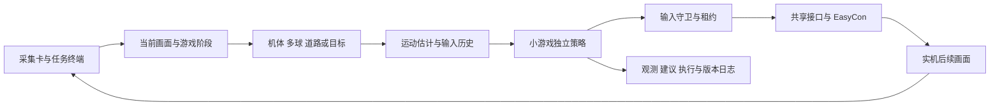

# Splatoon Raiders Minigame Helper

面向四项小游戏的采集、视觉识别、策略计算与 EasyCon 控制助手。当前 MINING 和 JUGGLING 已接入 Nintendo Switch 实机闭环，HOPPING、LANDING 保留独立的识别、预测与回放分析能力。

**2026-11-03 进度：**JUGGLING 最近三批共 9 局自主运行的原始结算图均已核对为 A 级，第五批为 **8400/A、9810/A、12435/A**。这组记录累计 34125 次观测；每局保留加载版本、参数、轨迹和实际输入证据。查看[实机结果索引](docs/evidence/juggling-20261103/summary.json)和[当前实现说明](docs/JUGGLING_LIVE.md)。

## 启动

在 Windows 项目目录优先使用已有的 conda base 环境：

```powershell
# JUGGLING 自主运行，默认三局，每局重新加载 AI
.\start_juggling_hot.cmd

# MINING 自主运行与局间更新
.\start_mining_hot.cmd

# 打开统一图形任务终端
.\start_live.cmd
```

JUGGLING 可使用 `start_juggling_hot.cmd --rounds 6` 指定轮数，或 `--rounds 0` 持续 Retry。入口可复用已连接的终端，也可打开新终端；先通过画面确认小游戏选择页或结算页，再闭环定位并进入游戏。默认不录制整段视频。终端持续持有采集卡与 EasyCon，AI 按局使用独立进程。

通用观察界面与手柄调试入口：

```powershell
python run.py task-terminal
python run.py gui
python run.py controller-debug
```

需要相应的 EasyCon ESP32-S3 硬件及固件。项目使用串口方案发送完整按钮、方向帽和双摇杆状态；默认采集设备为 0、串口为 COM5，可在终端修改。基础依赖见 `pyproject.toml`，连接控制器需安装 `pyserial`，研究拟合工具另使用 `scipy`。

## 当前实现

| 模块 | 当前能力 |
|---|---|
| 采集与终端 | DSHOW / MSMF / ANY、最新帧共享、图形任务设置、预览、人工调试、运行日志 |
| 控制与记录 | EasyCon / Dummy、双摇杆及组合键、输入租约与归中、实际发送前后时刻、阶段门控录像 |
| MINING | 自适应道路内边缘、机体与石头亮环识别、滚屏与速度种子、分模式积分、在线束搜索、混合 ZR 截止守卫、每局独立工作进程 |
| JUGGLING | 双角色识别、旋转鱼补检、多球身份关联、逐球二次短窗、反弹与接触预测、双侧任务分配、实际输入历史余程投影、空闲回中、生命和 Fever 观察、结算读分及局间更新 |
| HOPPING | 接球优先、目标与敌人跟踪、接触预测、强化外观、局部避敌与收益调度 |
| LANDING | 十布局图库、地形匹配、姿态模板、几何路径、喷射和制动建议 |
| 回放分析 | 视频播放、暂停与单帧、中文标注、JSONL、采集时钟与输入历史关联 |

JUGGLING 当前自主配置以接球为优先任务，分别控制左右摇杆。得分星使用独立目标类型，Fever 由量表及其消退过程维护。滑行探针、实机脉冲分析与经验位移拟合另行保存，当前自主配置采用双摇杆接球。

## 控制流程



`start_mining_hot.cmd`、`start_juggling_hot.cmd` 使用独立监督工作进程。普通 Engine 的控制许可检查仍由 `calibrated`、`advisory_only` 等配置决定，两种运行入口分别管理；参考视频与合成演示只产生建议。

每局记录源码摘要、配置摘要和实际加载版本。源代码或参数修改在下一局重新导入；GUI 与控制层修改需重开终端。结算等级由结果画面读取，数字分数另用五位字形库核对。JUGGLING 的停止目标可配置，默认目标为结果页 S。

## 验证与资料

2026-11-03 的 JUGGLING 定向回归为 **76 项通过**；项目不依赖 Tk 图形窗口的回归范围为 **1023 项通过**，排除了 `test_task_terminal_gui.py` 和 `test_live_debug_ui.py`。范围与耗时保存在[验证索引](docs/evidence/juggling-20261103/summary.json)。

- [项目实现说明书](docs/reports/SplatoonRaiders-Minigame-Helper_项目实现说明书.docx)
- [JUGGLING 实机实现与批次记录](docs/JUGGLING_LIVE.md)
- [图形任务终端与实机实验](docs/LIVE_EXPERIMENT.md)
- [MINING 纵向响应与模式实现](docs/MINING_FORWARD_EXPERIMENT.md)
- [视频分析](docs/VIDEO_ANALYSIS.md)
- [原项目协议移植与来源](docs/PROVENANCE.md)

完整实机采样、录像与临时实验保存在本地 `artifacts/`。仓库保存运行代码、配置、模板、测试、报告和精选原始结算图，结果图片在索引中附有 SHA-256。

## 其他命令

```powershell
python run.py demo --game mining --frames 120
python run.py mining-evaluate
python run.py ports
python run.py analyze-video <本地视频路径> --game juggling --start 720 --end 726 --annotated --output artifacts/my_juggling_analysis
python -m pytest -q
```

`gui` 的合成演示用于检查管线和策略表达，视频分析用于离线观察。参考视频及原始来源见[本地视频与章节](docs/LOCAL_VIDEO.md)、[调查记录](docs/RESEARCH.md)和[日文资料调查](docs/JAPANESE_SOURCES.md)。
